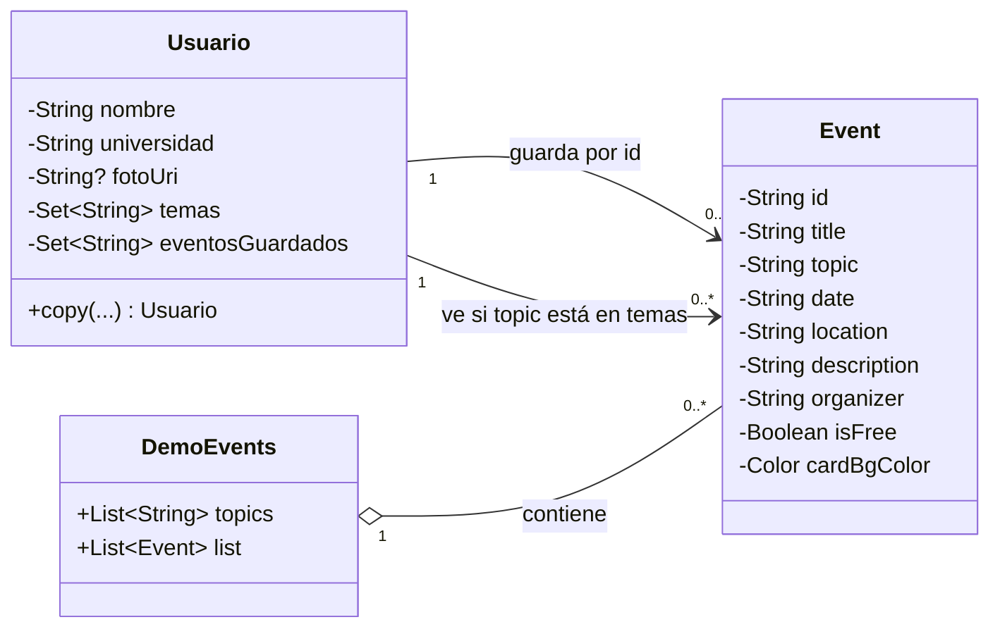

# PULZI · diagrama de clases del primer avance

Este diagrama representa el código actual del equipo. Los temas se guardan como textos sencillos (`String`) porque en esta entrega solo hay eventos de ejemplo.

## Explicación sencilla

- **Usuario** reúne los datos que se muestran en Perfil. `fotoUri` es la dirección de una foto elegida de la galería; puede estar vacía. `temas` contiene los intereses y `eventosGuardados` contiene los identificadores de los eventos marcados.
- **Event** representa un evento. `topic` es su tema, `id` permite guardarlo, y los otros campos aparecen en la tarjeta o en su detalle. En el código del equipo esta clase se llama **Event**; equivale a “Evento” en el diagrama conceptual.
- **DemoEvents** es la lista local de eventos y temas de muestra. Todavía no existe una base de datos.

## Cómo se conectan las pantallas

1. Ingreso o Registro entregan el nombre, universidad y temas a `MainActivity`. No se verifica la cuenta.
2. `MainActivity` mantiene un `Usuario` temporal. Inicio recibe sus temas y muestra solo los eventos cuyo `topic` coincide.
3. Al guardar un evento, su `id` entra o sale de `eventosGuardados`. La cantidad aparece en Perfil y la lista en Eventos.
4. Al tocar un tema en Perfil, se actualiza `Usuario.temas`. Al volver a Inicio aparecen las nuevas recomendaciones.
5. Cambiar foto abre la galería y actualiza `fotoUri`. Cerrar sesión vuelve al ingreso.

Los cambios viven en memoria durante esta demostración. Una versión posterior podrá separar las clases `Tema` y `EventoGuardado` y añadir almacenamiento, cuentas y reservas cuando esas funciones se implementen.
